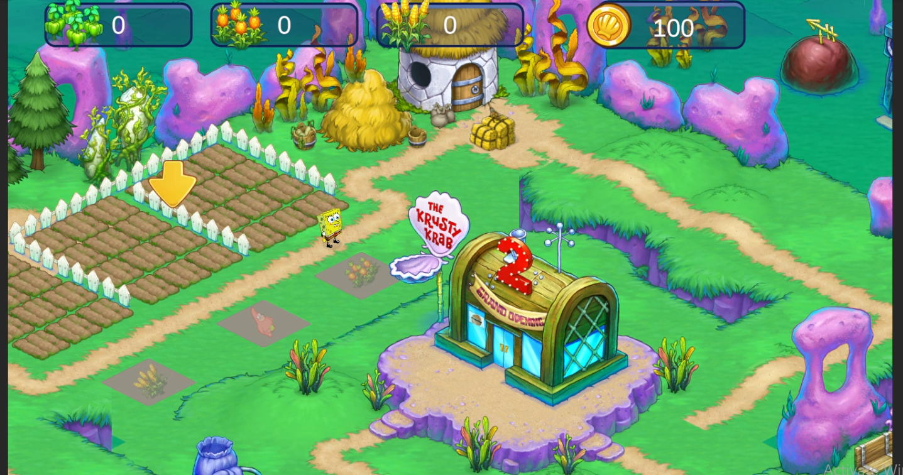

# SpongeBob Farming Mini-Game

### A little farming fun in Bikini Bottom.

## About the project

A light-hearted **2D advertising mini-game** developed using **Unity**, set in the whimsical world of SpongeBob SquarePants. Players help SpongeBob and his friends grow crops, collect eggs, and run their own underwater farm in Bikini Bottom.

The project brings a compact farming simulation into a colorful underwater setting, combining familiar characters and locations with simple resource-collection activities.

## Highlights

- **Crop growing:** Tend an underwater farm and grow crops.
- **Egg collection:** Collect eggs as part of the farming experience.
- **Bikini Bottom setting:** A colorful environment featuring SpongeBob and familiar surroundings.
- **2D presentation:** Illustrated scenery and characters bring the underwater farm to life.
- **Mini-game format:** A focused farming experience created as an advertising game.

## Technology

Built with **Unity** for the 2D game environment and farming interactions.

## Project focus

The project focuses on making everyday farming activities feel playful within the SpongeBob setting. Crop plots, resource counters, and a bright visual style communicate the farming loop at a glance.

## Repository purpose

This repository is a public portfolio showcase. It contains a project overview and screenshot; source code, executable builds, and standalone game assets are not included.

---

A project by [Kabbashi Gasim](https://github.com/kabashi1999).
